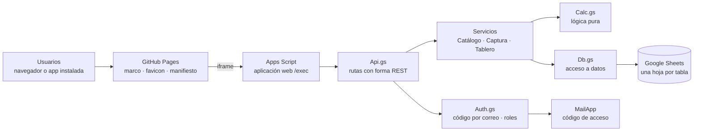

# Metas de Mastografía · Instituto de Salud de Chiapas

Plataforma web para el **seguimiento semanal de la meta estatal de mastografías**. Concentra la producción de todos los equipos que realizan estudios, la compara contra la meta y **predice con el ritmo actual si se cumplirá a tiempo**, indicando cuánto hay que acelerar, en qué jurisdicciones y por qué.

> Primera meta: **20,000 estudios al 31 de diciembre de 2026**.

Este repositorio contiene el **marco web** que se publica en GitHub Pages: muestra la plataforma con el favicon institucional y permite instalarla como aplicación. La plataforma en sí corre en Google Apps Script (ver [Arquitectura](#arquitectura)).

---

## El problema que resuelve

La producción de mastografías se reportaba de forma dispersa y no había una vista única que respondiera a tiempo:

1. ¿Vamos a llegar a la meta?
2. Si no, ¿cuánto falta y dónde?
3. ¿La brecha se debe a **falta de equipos** o a **su aprovechamiento**?

La plataforma responde las tres cada semana, con datos capturados por las propias jurisdicciones.

## Qué hace

### Equipos que se consideran

| Tipo | Área responsable | Comportamiento |
|---|---|---|
| **UMAC** · Unidad Médica de Atención Comunitaria | Dirección de Atención Médica | Rota entre jurisdicciones según itinerario mensual. |
| **UMAI** · Unidad Médica de Atención Integral | Salud de la Mujer | Rota con su propio itinerario; puede coincidir con una UMAC en la misma jurisdicción. |
| **Fijo** | Otras áreas que se integren | Se programa en la jurisdicción donde está instalado. |

Todos los equipos suman a la **misma meta estatal**. El número de equipos por mes es variable.

### Por rol

| Rol | Funciones |
|---|---|
| **Capturista** (jurisdicción) | Captura semanal por equipo: tamizaje, diagnóstico, sede, días sin servicio y resultados **BI-RADS 0 a 5**. Ve el avance de su jurisdicción, sus equipos programados y capturas pendientes. |
| **Coordinación estatal** | Tablero de solo lectura: indicadores, gráfica burndown, predicción con diagnóstico, BI-RADS acumulados, avance por jurisdicción, programación de equipos y **reporte imprimible en PDF**. |
| **Administrador** | Metas y reparto por jurisdicción, catálogo de equipos y áreas, programación mensual, días inhábiles, usuarios y corrección de capturas de semanas cerradas. |

### Reglas principales

- **Semanas ISO** (lunes a domingo). Una semana pertenece al mes de su jueves.
- **Cierre de captura:** lunes siguiente a las **14:00**. Después solo corrige el administrador, con registro en bitácora.
- **Un registro por equipo y semana.** Un equipo solo puede estar en una jurisdicción por mes; distintos equipos sí pueden coincidir.
- **Validación BI-RADS:** para enviar, la suma de BI-RADS 0–5 debe ser igual al total de estudios. Los borradores no cuentan para la meta.
- **Días hábiles:** todo se calcula en días hábiles (sin fines de semana ni días inhábiles registrados).
- **Jurisdicciones sin actividad:** si una jurisdicción no tiene equipos programados en el mes, aparece como *Sin actividad este mes* y **no se marca en riesgo**.

### Cómo predice

Los indicadores se calculan a la **fecha de corte** (domingo de la última semana cerrada):

| Indicador | Cálculo |
|---|---|
| Ritmo actual | Estudios por día hábil de las últimas 4 semanas (o promedio desde el inicio). |
| Ritmo requerido | Faltantes ÷ días hábiles restantes. |
| Proyección al cierre | Realizados + ritmo actual × días hábiles restantes. |
| Fecha estimada de cumplimiento | Corte + faltantes ÷ ritmo actual, en días hábiles. |
| Capacidad programada restante | Σ por equipo y mes: días programados × capacidad diaria (la del catálogo o la observada). |
| Aprovechamiento | Ritmo actual ÷ capacidad diaria de los equipos activos. |
| Esperado por jurisdicción | Proporción de la capacidad programada de la jurisdicción que ya transcurrió. |

**Semáforo estatal:** *En meta* si la proyección cubre ≥ 100 %; *En riesgo* entre 85 % y 99 %; *Crítico* por debajo de 85 %.
**Semáforo por jurisdicción:** real contra esperado ≥ 95 % *En meta*; 80–94 % *En riesgo*; < 80 % *Crítico*.

**Diagnóstico:** si la capacidad programada alcanza para lo que falta pero la proyección no, el problema es de **aprovechamiento** (equipos parados, días sin servicio, afluencia). Si tampoco alcanza la capacidad, el problema es de **capacidad** y se estima cuántos equipos adicionales harían falta.

La lógica es deliberadamente simple para que cualquier persona del equipo pueda explicarla y auditarla.

---

## Arquitectura

**Sin costo de licencias:** Google Apps Script, Google Sheets, GitHub Pages y Chart.js (código abierto).

### Capas

| Capa | Archivos | Responsabilidad |
|---|---|---|
| Configuración | `Config.gs` | Esquema único de las 11 tablas: tipos, catálogos, obligatorios y unicidad. |
| Datos | `Db.gs`, `Setup.gs` | CRUD sobre Sheets con validación, ids, unicidad, bloqueo y bitácora. Creación y siembra de la base. |
| Dominio | `Calc.gs` | Cálculos puros sin dependencias de Google: días hábiles, semanas, cierre, ritmo, proyección, capacidad, semáforos y burndown. |
| Servicios | `CatalogoService.gs`, `CapturaService.gs`, `TableroService.gs` | Reglas de negocio de cada módulo. |
| Acceso | `Auth.gs` | Identificación y permisos por rol. |
| API | `Api.gs` | `doGet` y despachador de rutas; respuesta `{ ok, data }` o `{ ok, error }`. |
| Interfaz | `Index`, `Styles`, `Logo`, `App`, `Tablero`, `Captura`, `Admin` (`.html`) | JavaScript sin frameworks, Chart.js para la gráfica, diseño adaptable a celular, paleta institucional y hoja de estilos de impresión. |
| Marco | Este repositorio | Página en GitHub Pages con iframe, manifiesto, service worker e íconos. |

### Modelo de datos

| Tabla | Contenido |
|---|---|
| `metas` | Nombre, cantidad, fecha de inicio y límite, estatus. |
| `metas_jurisdiccion` | Reparto opcional de la meta por jurisdicción. |
| `jurisdicciones` | Las 10 jurisdicciones sanitarias. |
| `areas` | Áreas responsables (Dirección de Atención Médica, Salud de la Mujer, otras). |
| `equipos` | Clave, tipo (UMAC, UMAI, FIJO), área, capacidad diaria, estatus. |
| `programacion_mensual` | Equipo, jurisdicción, año, mes, días hábiles programados y sedes. |
| `capturas` | Equipo, jurisdicción, periodo, sede, tamizaje, diagnóstico, total, BI-RADS 0–5, días sin servicio, estado, origen. |
| `cargas_historico` | Lotes de carga de histórico (fase 2). |
| `dias_inhabiles` | Calendario de días no laborables. |
| `usuarios` | Correo, nombre, rol, jurisdicción, activo. |
| `bitacora` | Quién hizo qué, cuándo y con qué datos. |

Solo se guardan **conteos agregados**; no hay datos de pacientes.

### API

| Método y ruta | Uso |
|---|---|
| `POST /auth/codigo` · `POST /auth/verificar` · `POST /auth/salir` · `GET /auth/yo` | Acceso por código y sesión. |
| `GET /catalogos` | Catálogos para la interfaz. |
| `GET /metas/:id/tablero` | Indicadores, burndown, predicción, jurisdicciones, BI-RADS y programación. |
| `GET /metas/:id/avance` · `/burndown` · `/jurisdicciones` · `/birads` | Partes del tablero por separado. |
| `GET` · `PUT /metas/:id/reparto` | Reparto de la meta por jurisdicción. |
| `GET /captura/contexto` | Semanas abiertas, equipos programados, avance y pendientes de una jurisdicción. |
| `GET` · `POST /capturas` · `PUT /capturas/:id` | Consulta, alta y corrección de capturas. |
| `PUT /programacion` | Guardado de la programación mensual en lote. |
| `GET` · `POST` · `PUT` · `DELETE /:recurso` | Catálogos: `metas`, `equipos`, `areas`, `jurisdicciones`, `programacion`, `dias-inhabiles`, `usuarios`. |

### Acceso y seguridad

- La aplicación se publica con acceso abierto; la identificación es por **código de 6 dígitos enviado al correo registrado** (vence en 10 minutos, 5 intentos, un envío por minuto). La sesión dura 6 horas.
- Solo entran correos registrados y activos. La respuesta al pedir un código es la misma exista o no el correo.
- Los permisos se validan en el servidor en cada ruta; el capturista queda limitado a su jurisdicción.
- Toda escritura usa bloqueo para evitar que dos capturas se pisen, y queda en bitácora.

---

## Este repositorio: marco para GitHub Pages

| Archivo | Uso |
|---|---|
| `index.html` | Marco a pantalla completa con la plataforma y pantalla de carga. La liga `/exec` está en la variable `APP_URL`. |
| `manifest.webmanifest` | Nombre, colores e íconos de la aplicación instalada. |
| `sw.js` | Service worker mínimo para permitir la instalación. No guarda datos de la plataforma. |
| `favicon.ico` | Favicon institucional. |
| `apple-touch-icon.png` | Ícono en iPhone / iPad. |
| `icon-192.png`, `icon-512.png`, `icon-maskable-512.png` | Íconos de la aplicación instalada. |

### Publicar

1. La aplicación de Apps Script debe permitir mostrarse en marco (`XFrameOptionsMode.ALLOWALL` en `doGet`).
2. Sube los archivos de este repositorio a la raíz de la rama `main`.
3. **Settings › Pages**: *Deploy from a branch*, rama **main**, carpeta **/ (root)**.
4. Si cambia la liga `/exec`, actualiza `APP_URL` en `index.html`. Si cambian los íconos, sube la versión de la caché en `sw.js`.

### Instalar como aplicación

- **Chrome / Edge:** ícono de instalar en la barra de direcciones.
- **Android:** menú › *Instalar aplicación*.
- **iPhone:** Compartir › *Agregar a pantalla de inicio*.

---

## Calidad

- **61 pruebas automatizadas** sobre un simulador de los servicios de Google en Node: capa de datos, cálculos contra un escenario resuelto a mano y flujo completo por la API (acceso, permisos, cierre semanal, coincidencia UMAC + UMAI, correcciones y tablero).
- Recorrido de todas las pantallas en Chromium, sin errores de consola y sin desbordes en celular.
- Generación del reporte PDF verificada en estado completo y por jurisdicción.

## Límites conocidos

- Google limita el envío de códigos a 100 correos al día con cuenta personal (1,500 con Workspace).
- Algunos navegadores (Safari, incógnito) bloquean el almacenamiento dentro de marcos: puede pedirse el código al recargar.
- Google Sheets es adecuado para el volumen actual (un registro por equipo y semana); la migración a MariaDB resuelve el crecimiento.

## Hoja de ruta

| Fase | Alcance |
|---|---|
| **1 · Operación** (implementada) | Captura semanal, tablero, predicción, BI-RADS, programación, usuarios, correcciones, reporte PDF y marco instalable. |
| **2 · Histórico y alertas** | Carga del histórico con validación y lotes reversibles; alerta semanal por correo cuando el semáforo cambie. |
| **3 · Institucionalización** | Seguimiento puntual de pacientes BI-RADS 4–5 e integración a la plataforma institucional (**Laravel 12, MariaDB, Angular 20/21**), sujeta a la solicitud formal al área de Informática. |

El diseño facilita la migración: el esquema de `Config.gs` se traduce a migraciones de Laravel, `Calc.gs` a un Service con las mismas pruebas, las rutas de `Api.gs` a `routes/api.php` y las vistas a componentes de Angular.

---

**Instituto de Salud de Chiapas · Dirección de Atención Médica**
Product Manager / Transformation Lead: Saúl Díaz Torres
